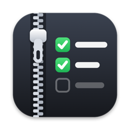
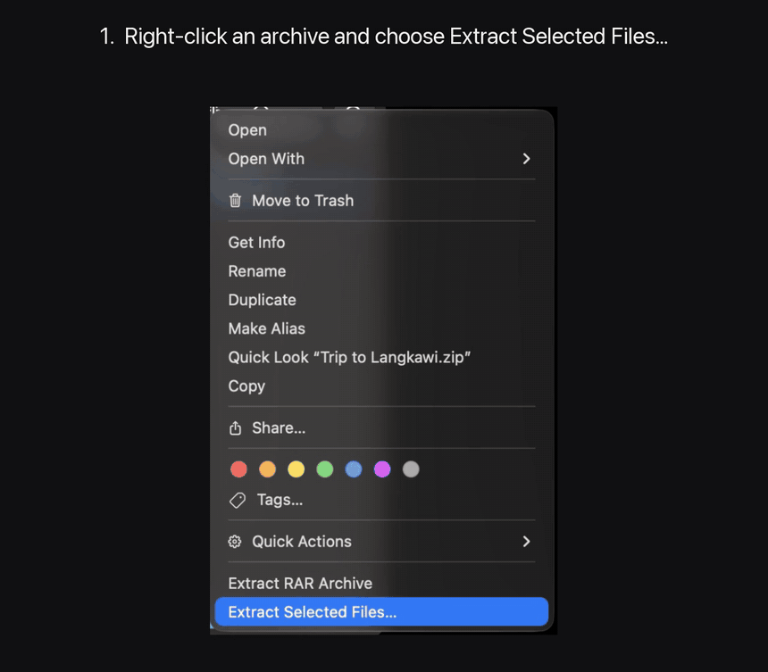
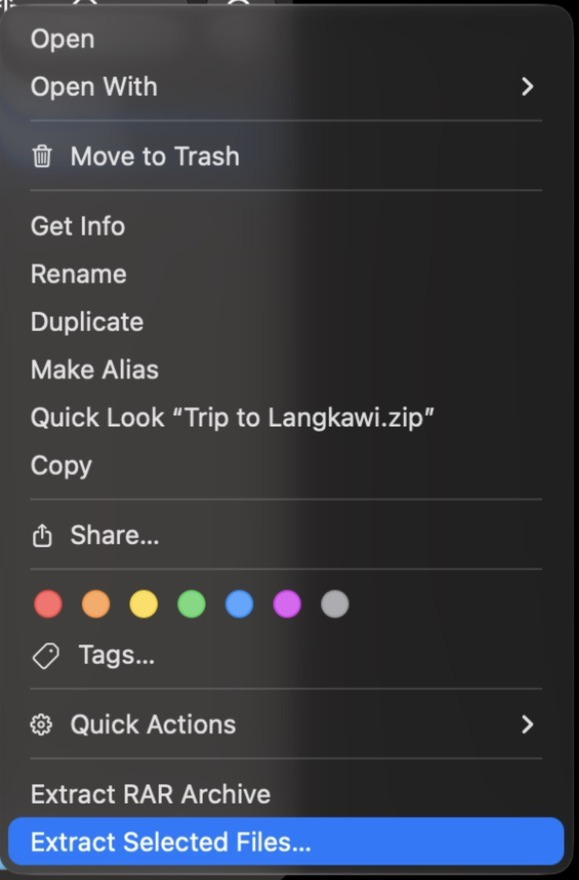
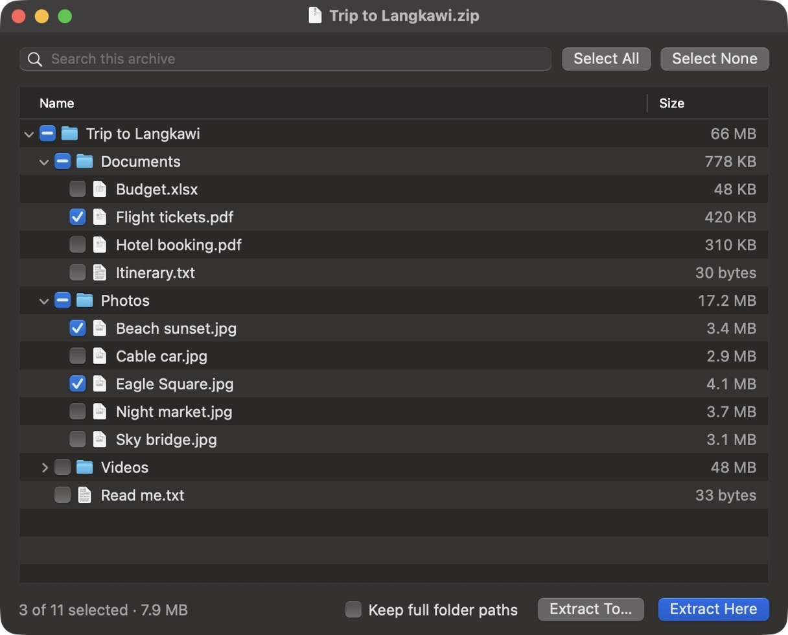
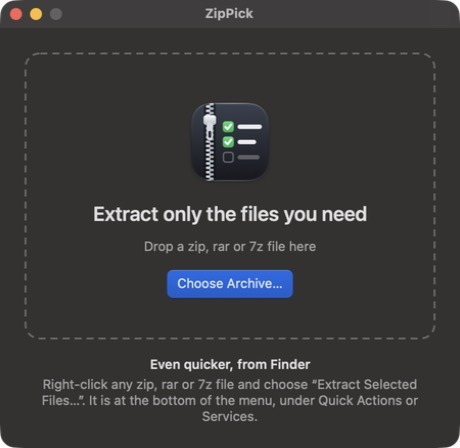

<p align="center"></p>

<h1 align="center">ZipPick</h1>

<p align="center">Unzip only the files you need. A free, open source Mac app for zip, rar and 7z.</p>

<p align="center"><a href="https://github.com/artcreator329/ZipPick/releases/latest/download/ZipPick.dmg"><b>Download ZipPick for Mac</b></a></p>



Double-clicking an archive on a Mac unpacks everything in it. ZipPick lets you look inside
first, tick the files or folders you want, and unpack just those.

## Install

1. [Download ZipPick.dmg](https://github.com/artcreator329/ZipPick/releases/latest/download/ZipPick.dmg) and open it.
2. Drag **ZipPick** onto the **Applications** folder.
3. Open ZipPick from Applications once. This also adds it to Finder's right-click menu.

ZipPick is signed and notarized by Apple, so it opens like any other downloaded app: macOS asks
once whether you want to open it, and you click **Open**.

Works on macOS 13 or later, on Apple Silicon and Intel Macs.

## How to use it

**1. Right-click an archive in Finder and choose "Extract Selected Files…".**
It is near the bottom of the menu. On some Macs it sits inside **Quick Actions** or **Services**.



**2. Tick what you want, then click "Extract Here".**
The files appear next to the archive. Use **Extract To…** to pick a different folder.



You can also open ZipPick on its own and drop an archive onto its window.



### Handy to know

- Tick a folder to take everything in it.
- Type in the search box to find files in a big archive. **Select All** then ticks only the matches.
- Press Space to tick or untick the highlighted rows.
- ZipPick leaves out the folders above your selection: ticking `Trip/Photos/Beach.jpg` gives you
  `Beach.jpg`, and ticking the `Photos` folder gives you `Photos/`. Turn on
  **Keep full folder paths** if you want `Trip/Photos/` recreated as well.
- If a file already exists, ZipPick asks whether to replace it or skip it.

A short video of the steps is in [docs/demo.mp4](docs/demo.mp4).

### The right-click entry is missing

Open ZipPick once from Applications, then try again. If it is still missing, open
**System Settings → Keyboard → Keyboard Shortcuts → Services → Files and Folders** and tick
**Extract Selected Files…**.

## What it supports

| Format | Notes |
|---|---|
| zip | Including very large (ZIP64) archives and non-English file names |
| rar | Read with the archive reader built into macOS. Some newer or unusual rar files may not open |
| 7z | Read with the archive reader built into macOS |

Not supported yet: password-protected archives, multi-part archives, and tar or gz files.

## Privacy

ZipPick works entirely on your Mac. It has no accounts, no analytics and makes no network
connections.

## Build it yourself

You need Xcode (or its command line tools) with Swift 5.9 or later.

```bash
./build.sh install
```

That builds `dist/ZipPick.app`, copies it to `/Applications` and registers the Finder action.
`./build.sh dmg` packages `dist/ZipPick.dmg` for sharing.

To make a DMG that other Macs open without a warning, sign it with a Developer ID certificate
and notarize it:

```bash
SIGN_IDENTITY="Developer ID Application: Your Name (TEAMID)" ./build.sh dmg
xcrun notarytool submit dist/ZipPick.dmg --keychain-profile YOUR_PROFILE --wait
xcrun stapler staple dist/ZipPick.dmg
```

Project layout:

- `Sources/ZipPick/ZipArchive.swift`: native zip reader and extractor.
- `Sources/ZipPick/SystemToolArchive.swift`: rar and 7z through macOS's `bsdtar`.
- `Sources/ZipPick/ArchiveTree.swift`: the folder tree, ticks, search and extraction plan.
- `Sources/ZipPick/PickerWindowController.swift`, `WelcomeWindowController.swift`: the windows.
- `Sources/ZipPick/AppDelegate.swift`: opening files, menus and the Finder service.
- `Resources/Info.plist`: declares the Finder service and the supported file types.
- `scripts/make-icon.sh`: regenerates the app icon.

The engine can be tried without the window:

```bash
dist/ZipPick.app/Contents/MacOS/ZipPick --list archive.zip
```

```bash
dist/ZipPick.app/Contents/MacOS/ZipPick --extract archive.zip out-folder path/in/archive
```

## Contributing

Issues and pull requests are welcome. Ideas that would help most: password support, more
formats, and translations.

## License

[MIT](LICENSE)
